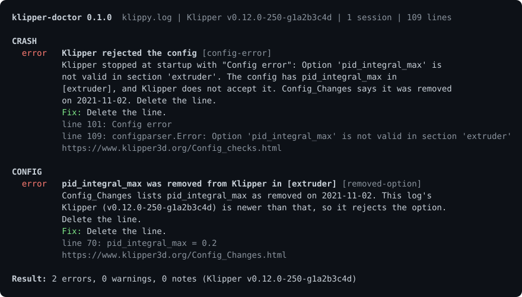

# klipper-doctor

Give it a `klippy.log` or a `printer.cfg`. It tells you in plain English why the print or session died, and lints the config the way ShellCheck lints a shell script.



Run it with no install:

```sh
npx github:kd-011/klipper-doctor klippy.log
```

## Use it in 20 seconds

```sh
klipper-doctor klippy.log            # crash report and config report
klipper-doctor printer.cfg           # config report only
klipper-doctor --md klippy.log       # paste-ready for a Reddit or Discord thread
klipper-doctor --json klippy.log     # machine-readable
klipper-doctor --config-only klippy.log
cat klippy.log | klipper-doctor -    # read stdin
```

Exit code is 1 when any finding is an error, 0 otherwise, and 2 for a usage or read error.

Klipper writes the parsed config into `klippy.log` at the start of every run, so one log gives you both reports. When the log holds several Klipper starts, the last one is analysed and the count is reported.

Use it as a library (ESM, no dependencies, runs in Node and in the browser):

```js
import { analyze, toMarkdown } from 'klipper-doctor';

const report = analyze(text, { filename: 'klippy.log' });
report.crash;   // Finding[]: why the session died, or a plain "no failure found"
report.config;  // Finding[]: error, warning and note findings on the config
toMarkdown(report);
```

Each finding has an `id`, a `severity` (`error`, `warning` or `note`), a `title`, a `detail`, a one-line `fix`, a `docs` link and `evidence` lines with their line numbers.

## What it checks

Every rule is taken from the Klipper docs or source. The crash rules match message strings copied from the Klipper source, and each rule links the page or file it comes from.

<!-- rules:start -->
| Rule | Report | Severity | What it catches | Source |
| --- | --- | --- | --- | --- |
| `config-error` | crash | error | Klipper rejected the config | [docs](https://www.klipper3d.org/Config_checks.html) |
| `mcu-protocol-mismatch` | crash | error | MCU firmware does not match the host | [docs](https://www.klipper3d.org/Installation.html#building-and-flashing-the-micro-controller) |
| `mcu-connect-failed` | crash | error | Unable to connect to the MCU | [docs](https://www.klipper3d.org/FAQ.html#wheres-my-serial-port) |
| `mcu-lost-communication` | crash | error | Lost communication with MCU | [docs](https://www.klipper3d.org/FAQ.html#i-keep-getting-random-lost-communication-with-mcu-errors) |
| `mcu-timer-too-close` | crash | error | Timer too close | [docs](https://github.com/Klipper3d/klipper/blob/master/klippy/extras/error_mcu.py) |
| `mcu-missed-scheduling` | crash | error | Missed scheduling of next event | [docs](https://www.klipper3d.org/FAQ.html#i-keep-getting-random-lost-communication-with-mcu-errors) |
| `mcu-step-rate` | crash | error | Stepping faster than the MCU can manage | [docs](https://www.klipper3d.org/Benchmarks.html) |
| `mcu-adc-out-of-range` | crash | error | ADC out of range | [docs](https://github.com/Klipper3d/klipper/blob/master/klippy/extras/error_mcu.py) |
| `mcu-command-request` | crash | error | Shutdown requested by command | [docs](https://github.com/Klipper3d/klipper/blob/master/klippy/extras/error_mcu.py) |
| `mcu-spontaneous-restart` | crash | error | MCU restarted by itself | [docs](https://www.klipper3d.org/FAQ.html#i-keep-getting-random-lost-communication-with-mcu-errors) |
| `heater-verify` | crash | error | Heater not heating at expected rate | [docs](https://www.klipper3d.org/Config_Reference.html#verify_heater) |
| `tmc-comm` | crash | error | Cannot talk to a TMC driver | [docs](https://www.klipper3d.org/TMC_Drivers.html#i-keep-getting-unable-to-read-tmc-uart-stepper_x-register-ifcnt-errors) |
| `tmc-reports-error` | crash | error | TMC driver reports an error | [docs](https://www.klipper3d.org/TMC_Drivers.html#why-did-i-get-a-tmc-reports-error-error) |
| `stepcompress-internal-error` | crash | error | Internal error in stepcompress | [docs](https://github.com/Klipper3d/klipper/blob/master/klippy/stepper.py) |
| `move-out-of-range` | crash | warning | Move out of range | [docs](https://www.klipper3d.org/FAQ.html#why-cant-i-move-the-stepper-before-homing-the-printer) |
| `must-home-first` | crash | warning | Must home axis first | [docs](https://www.klipper3d.org/FAQ.html#why-cant-i-move-the-stepper-before-homing-the-printer) |
| `crash-unknown-reason` | crash | error | Shutdown with a reason no rule knows | [docs](https://www.klipper3d.org/FAQ.html#why-does-klipper-report-errors-i-lost-my-print) |
| `no-failure-found` | crash | note | No failure found in the log | [docs](https://www.klipper3d.org/FAQ.html) |
| `unparseable-line` | config | error | Line Klipper cannot parse | [docs](https://github.com/Klipper3d/klipper/blob/master/klippy/configfile.py) |
| `gcode-unindented` | config | error | Unindented line inside a gcode: block | [docs](https://www.klipper3d.org/Command_Templates.html) |
| `duplicate-option` | config | warning | Option set twice in one section | [docs](https://github.com/Klipper3d/klipper/blob/master/klippy/configfile.py) |
| `duplicate-section` | config | warning | Section appears twice | [docs](https://github.com/Klipper3d/klipper/blob/master/klippy/configfile.py) |
| `save-config-duplicate` | config | warning | Option is in the main config and the SAVE_CONFIG block | [docs](https://github.com/Klipper3d/klipper/blob/master/klippy/configfile.py) |
| `removed-option` | config | warning | Option or value removed from Klipper | [docs](https://www.klipper3d.org/Config_Changes.html) |
| `deprecated-option` | config | warning | Option renamed and deprecated | [docs](https://www.klipper3d.org/Config_Changes.html) |
| `missing-required` | config | error | Required option missing | [docs](https://www.klipper3d.org/Config_Reference.html) |
| `endstop-range` | config | error | position_endstop does not fit the axis | [docs](https://github.com/Klipper3d/klipper/blob/master/klippy/stepper.py) |
| `safe-z-home-conflict` | config | error | [safe_z_home] and [homing_override] together | [docs](https://github.com/Klipper3d/klipper/blob/master/klippy/extras/safe_z_home.py) |
| `tmc-stealthchop-threshold` | config | note | stealthchop_threshold switches modes while moving | [docs](https://www.klipper3d.org/TMC_Drivers.html#setting-spreadcycle-vs-stealthchop-mode) |
| `no-input-shaper` | config | note | No [input_shaper] section | [docs](https://www.klipper3d.org/Resonance_Compensation.html) |
| `includes-not-read` | config | note | Included files were not read | [docs](https://github.com/Klipper3d/klipper/blob/master/klippy/configfile.py) |
| `no-config-dump` | config | note | No config dump in the log | [docs](https://github.com/Klipper3d/klipper/blob/master/klippy/configfile.py) |
<!-- rules:end -->

Message strings were checked against Klipper's `master` branch on 2026-11-02. Older Klipper versions can word a message differently, and the tool says so when a rule does not match rather than guessing.

## How it differs

There are good tools for looking at a `klippy.log` already. [Klipper Log Visualizer](https://klipper.discourse.group/t/klipper-log-visualizer/24281) by Sineos graphs the data in a log in the browser, and [klipper_logs](https://klipper.discourse.group/t/fancy-klipper-logs-parser/18937) by CODeRUS collects and graphs logs too. Klipper itself ships `scripts/logextract.py` for pulling out shutdown information. klipper-doctor is a companion to those, not a replacement: use a grapher to see what the temperatures and the load did, and use this to get the cause and the fix in words, plus a lint of the config.

## Privacy

It runs on your machine. The CLI reads the file you name and prints the result. Nothing is uploaded or stored.

## Limits

- It reads one file. Options in files pulled in by `[include]` are not checked in a raw `printer.cfg`, and it says so. A `klippy.log` has the includes already merged, so prefer that.
- It reads `klippy.log` only. Moonraker's own log is a different file and is not parsed.
- It cannot see a failure that left no trace in the log.

## Contributing

A rule is a small object: an id, a severity, a title, a detail, a fix, a `docs` link and a `check` function. To add one:

1. Find the claim in the Klipper docs or source. No source, no rule. Copy any message string from the source rather than from memory, and put the file or page in a comment above the rule and in `docs`.
2. Add the rule in `src/core/rules/config/` (config) or `src/core/rules/crash/` (crash) and list it in that folder's `index.ts`.
3. Add a fixture in `test/fixtures/` with a header comment saying how it was made. For a log fixture, add it to `scripts/make-fixtures.mjs` and run `npm run fixtures`. Never use a real person's log.
4. Add the rule to the expectations in `test/crash.test.mjs` or `test/config.test.mjs`.
5. Run `npm test` (it builds first), then `npm run docs` to refresh the table above.

`src/core/` must stay free of Node APIs so it runs in a browser unchanged. Only `src/cli.ts` touches the filesystem. Copy for findings follows the same voice as this page: plain English, no em dashes, no marketing words.

## Built by Hotend

Built by [Hotend](https://hotend.app), which watches your printer from your phone and catches failures live.

## Licence

MIT. See [LICENSE](LICENSE).
