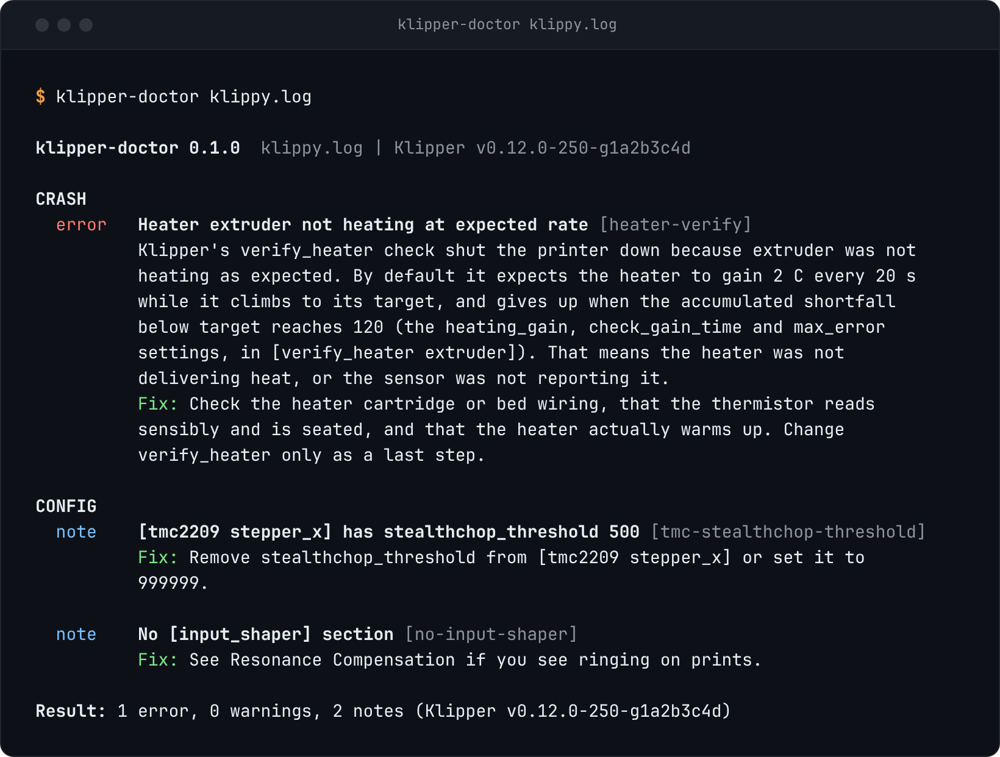

# klipper-doctor

[](https://www.npmjs.com/package/klipper-doctor)
[](https://github.com/kd-011/klipper-doctor/actions/workflows/ci.yml)
[](LICENSE)
[](package.json)

Give it a `klippy.log` or a `printer.cfg`. It tells you in plain English why the print or session died, and lints the config the way ShellCheck lints a shell script.

```sh
npx klipper-doctor klippy.log
```

<picture>
  <source media="(max-width: 600px)" srcset="assets/demo-hero.png">
  
</picture>

Or install it: `npm i -g klipper-doctor`. Node 18 or newer. It also runs in your browser at [hotend.app/klipper-doctor](https://hotend.app/klipper-doctor), and nothing you drop there is uploaded.

## What it catches

Klipper's own messages are terse. These are real outputs, from test logs built out of the message formats in the Klipper source (never from anyone's real log).

**Lost communication**

```text
Timeout with MCU 'mcu' (eventtime=5014.912345)
Transition to shutdown state: Lost communication with MCU 'mcu'
```

```text
error   Lost communication with MCU [mcu-lost-communication]
        Klipper lost contact with MCU 'mcu' and shut down. The Klipper FAQ says this
        is commonly caused by hardware errors on the USB connection: a poor cable or
        loose plugs, a weak power supply for the host (look for "under voltage"
        warnings), an overloaded printer power supply, frayed or crimped stepper,
        heater or sensor wires, or the printer and host 5V supplies being mixed.
        Fix: Use a good USB cable with secure plugs, a good power supply for the host,
        and check the printer wiring and power supply load.
```

**Timer too close**

```text
MCU 'mcu' shutdown: Timer too close
```

```text
error   Timer too close [mcu-timer-too-close]
        MCU 'mcu' shut down with "Timer too close": a command reached it after the
        time it was scheduled to run. Klipper's own hint is that this often indicates
        the host computer is overloaded: other processes using too much CPU, high swap
        use, disk errors, overheating or unstable voltage.
        Fix: Check the host for processes using a lot of CPU, high swap use, disk
        errors, overheating or unstable power, then run FIRMWARE_RESTART.
```

**A TMC driver that will not answer**

```text
Unable to read tmc uart 'stepper_x' register IFCNT
```

```text
error   Cannot talk to a TMC driver [tmc-comm]
        Klipper could not read register IFCNT on the TMC driver for stepper_x over
        UART. The Klipper TMC guide says to make sure motor power is enabled, because
        the driver generally needs it before it will answer. If this started right
        after flashing Klipper for the first time, the driver may have been left in a
        state Klipper cannot use: remove all power, USB and mains, for several
        seconds. Otherwise it is usually wrong UART wiring or wrong UART pin settings
        in the config.
        Fix: Turn motor power on, then power-cycle the printer fully; if it persists,
        check the uart_pin, tx_pin and uart_address settings against the wiring.
```

**An option Klipper removed** (the config report: no crash needed)

```text
[extruder]
...
pid_integral_max = 0.2
```

```text
error   pid_integral_max was removed from Klipper in [extruder] [removed-option]
        Config_Changes lists pid_integral_max as removed on 2021-11-02. This log's
        Klipper (v0.12.0-250-g1a2b3c4d) is newer than that, so it rejects the option.
        Delete the line.
        Fix: Delete the line.
```

Every finding also carries the line numbers it came from and a link to the Klipper docs page or source file behind it.

## How it differs

There are good tools for looking at a `klippy.log` already. [Klipper Log Visualizer](https://klipper.discourse.group/t/klipper-log-visualizer/24281) by Sineos graphs the data in a log in the browser, and [klipper_logs](https://coderus.openrepos.net/klipper_logs/) by CODeRUS collects and graphs logs too. Klipper itself ships `scripts/logextract.py` for pulling the config and shutdown information out of a log. For the config side, [klipper-cfg-linter](https://github.com/chexxor/klipper-cfg-linter) by chexxor is an early project with the same aim as the config report here.

klipper-doctor is a companion to those, not a replacement: use a grapher to see what the temperatures and the load did, and use this to get the cause and the fix in words, plus a lint of the config.

## Use it

```sh
klipper-doctor klippy.log            # crash report and config report
klipper-doctor printer.cfg           # config report only
klipper-doctor --md klippy.log       # paste-ready for a Reddit or Discord thread
klipper-doctor --json klippy.log     # machine-readable
klipper-doctor --config-only klippy.log
cat klippy.log | klipper-doctor -    # read stdin
```

Exit code is 1 when any finding is an error, 0 otherwise, and 2 for a usage or read error.

Klipper writes the parsed config into `klippy.log` at the start of every run, so one log gives you both reports. When the log holds several Klipper starts, the last one is analysed and the count is reported.

### As a library

ESM, no dependencies, runs in Node and in the browser. Only the CLI touches the filesystem.

```js
import { analyze, toMarkdown } from 'klipper-doctor';

const report = analyze(text, { filename: 'klippy.log' });
report.crash;   // Finding[]: why the session died, or a plain "no failure found"
report.config;  // Finding[]: error, warning and note findings on the config
toMarkdown(report);
```

Each finding has an `id`, a `severity` (`error`, `warning` or `note`), a `title`, a `detail`, a one-line `fix`, a `docs` link and `evidence` lines with their line numbers. `rulesMetadata()` lists every rule. Types ship with the package.

## Rules

Every rule is taken from the Klipper docs or source. The crash rules match message strings copied from the Klipper source, and each rule links the page or file it comes from.

<!-- rules:start -->
| Rule | Report | Severity | What it catches | Source |
| --- | --- | --- | --- | --- |
| `config-error` | crash | error | Klipper rejected the config | [docs](https://www.klipper3d.org/Config_checks.html) |
| `mcu-protocol-mismatch` | crash | error | MCU firmware does not match the host | [docs](https://www.klipper3d.org/Installation.html#building-and-flashing-the-micro-controller) |
| `mcu-connect-failed` | crash | error | Unable to connect to the MCU | [docs](https://www.klipper3d.org/FAQ.html#wheres-my-serial-port) |
| `mcu-lost-communication` | crash | error | Lost communication with MCU | [docs](https://www.klipper3d.org/FAQ.html#i-keep-getting-random-lost-communication-with-mcu-errors) |
| `mcu-timer-too-close` | crash | error | Timer too close | [docs](https://github.com/Klipper3d/klipper/blob/master/klippy/extras/error_mcu.py) |
| `mcu-missed-scheduling` | crash | error | Missed scheduling of next event | [docs](https://www.klipper3d.org/FAQ.html#i-keep-getting-random-lost-communication-with-mcu-errors) |
| `mcu-step-rate` | crash | error | Stepping faster than the MCU can manage | [docs](https://www.klipper3d.org/Benchmarks.html) |
| `mcu-adc-out-of-range` | crash | error | ADC out of range | [docs](https://github.com/Klipper3d/klipper/blob/master/klippy/extras/error_mcu.py) |
| `mcu-command-request` | crash | error | Shutdown requested by command | [docs](https://github.com/Klipper3d/klipper/blob/master/klippy/extras/error_mcu.py) |
| `mcu-spontaneous-restart` | crash | error | MCU restarted by itself | [docs](https://www.klipper3d.org/FAQ.html#i-keep-getting-random-lost-communication-with-mcu-errors) |
| `heater-verify` | crash | error | Heater not heating at expected rate | [docs](https://www.klipper3d.org/Config_Reference.html#verify_heater) |
| `tmc-comm` | crash | error | Cannot talk to a TMC driver | [docs](https://www.klipper3d.org/TMC_Drivers.html#i-keep-getting-unable-to-read-tmc-uart-stepper_x-register-ifcnt-errors) |
| `tmc-reports-error` | crash | error | TMC driver reports an error | [docs](https://www.klipper3d.org/TMC_Drivers.html#why-did-i-get-a-tmc-reports-error-error) |
| `stepcompress-internal-error` | crash | error | Internal error in stepcompress | [docs](https://github.com/Klipper3d/klipper/blob/master/klippy/stepper.py) |
| `move-out-of-range` | crash | warning | Move out of range | [docs](https://www.klipper3d.org/FAQ.html#why-cant-i-move-the-stepper-before-homing-the-printer) |
| `must-home-first` | crash | warning | Must home axis first | [docs](https://www.klipper3d.org/FAQ.html#why-cant-i-move-the-stepper-before-homing-the-printer) |
| `crash-unknown-reason` | crash | error | Shutdown with a reason no rule knows | [docs](https://www.klipper3d.org/FAQ.html#why-does-klipper-report-errors-i-lost-my-print) |
| `no-failure-found` | crash | note | No failure found in the log | [docs](https://www.klipper3d.org/FAQ.html) |
| `unparseable-line` | config | error | Line Klipper cannot parse | [docs](https://github.com/Klipper3d/klipper/blob/master/klippy/configfile.py) |
| `gcode-unindented` | config | error | Unindented line inside a gcode: block | [docs](https://www.klipper3d.org/Command_Templates.html) |
| `duplicate-option` | config | warning | Option set twice in one section | [docs](https://github.com/Klipper3d/klipper/blob/master/klippy/configfile.py) |
| `duplicate-section` | config | warning | Section appears twice | [docs](https://github.com/Klipper3d/klipper/blob/master/klippy/configfile.py) |
| `save-config-duplicate` | config | warning | Option is in the main config and the SAVE_CONFIG block | [docs](https://github.com/Klipper3d/klipper/blob/master/klippy/configfile.py) |
| `removed-option` | config | warning | Option or value removed from Klipper | [docs](https://www.klipper3d.org/Config_Changes.html) |
| `deprecated-option` | config | warning | Option renamed and deprecated | [docs](https://www.klipper3d.org/Config_Changes.html) |
| `missing-required` | config | error | Required option missing | [docs](https://www.klipper3d.org/Config_Reference.html) |
| `endstop-range` | config | error | position_endstop does not fit the axis | [docs](https://github.com/Klipper3d/klipper/blob/master/klippy/stepper.py) |
| `safe-z-home-conflict` | config | error | [safe_z_home] and [homing_override] together | [docs](https://github.com/Klipper3d/klipper/blob/master/klippy/extras/safe_z_home.py) |
| `tmc-stealthchop-threshold` | config | note | stealthchop_threshold switches modes while moving | [docs](https://www.klipper3d.org/TMC_Drivers.html#setting-spreadcycle-vs-stealthchop-mode) |
| `no-input-shaper` | config | note | No [input_shaper] section | [docs](https://www.klipper3d.org/Resonance_Compensation.html) |
| `includes-not-read` | config | note | Included files were not read | [docs](https://github.com/Klipper3d/klipper/blob/master/klippy/configfile.py) |
| `no-config-dump` | config | note | No config dump in the log | [docs](https://github.com/Klipper3d/klipper/blob/master/klippy/configfile.py) |
<!-- rules:end -->

Message strings were checked against Klipper's `master` branch on 2026-11-02. Older Klipper versions can word a message differently, and the tool says so when a rule does not match rather than guessing.

## In the browser

The same engine runs at [hotend.app/klipper-doctor](https://hotend.app/klipper-doctor), free and with no signup. The analysis happens in your browser. The log is not uploaded and not stored.

The CLI is the same: it reads the file you name, prints the result, and sends nothing anywhere.

## Limits

- It reads one file. Options in files pulled in by `[include]` are not checked in a raw `printer.cfg`, and it says so. A `klippy.log` has the includes already merged, so prefer that.
- It reads `klippy.log` only. Moonraker's own log is a different file and is not parsed.
- It cannot see a failure that left no trace in the log.

## Contributing

Wrong diagnosis, or a rule you want? Open an issue with a redacted log snippet or a docs link. To add a rule yourself, see [CONTRIBUTING.md](CONTRIBUTING.md): a rule is a small object, and the one hard requirement is a Klipper docs page or source file behind it. No source, no rule.

## Built by Hotend

Built by [Hotend](https://hotend.app), which watches your printer from your phone and catches failures live.

## Licence

MIT. See [LICENSE](LICENSE). Release notes are in [CHANGELOG.md](CHANGELOG.md).
